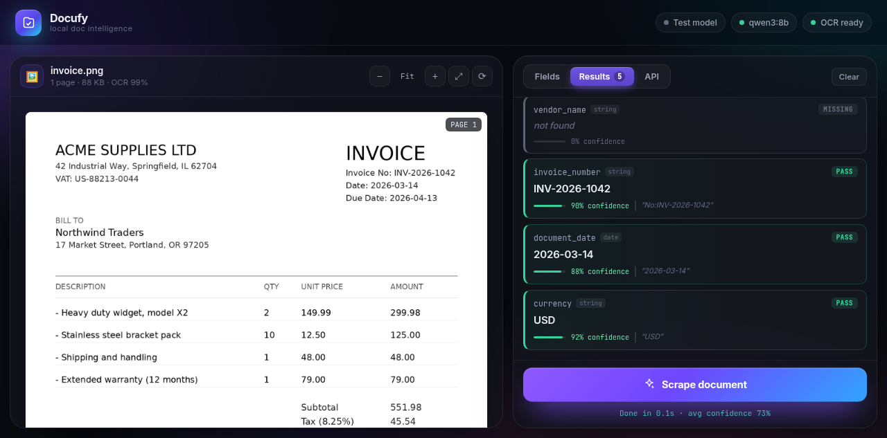
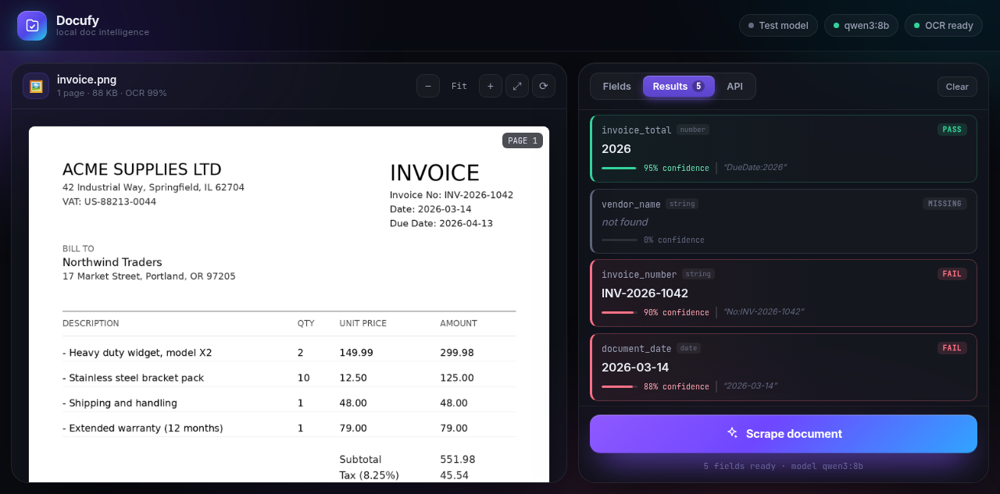
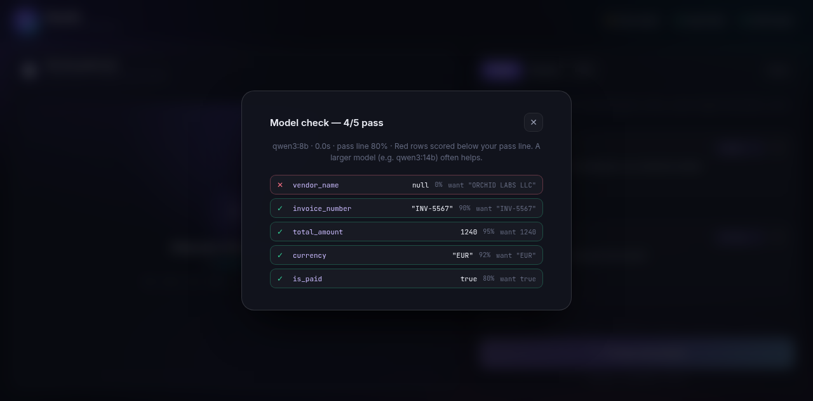

# Docufy

Point it at a document, tell it what to pull out, get clean JSON back with a
confidence score for every field. Everything runs on your Mac: OCR on CPU,
the LLM through your own Ollama install. Nothing leaves the machine.



## How this was built

Docufy came from **one prompt**: a description of the whole product. From that,
the agent designed the architecture, wrote both halves of the app, ran its own
tests in a real browser, found its own bugs, and fixed them — without any
further product direction.

Built with **DeepSeek V4.1 Flash 1017** in [Factory](https://factory.ai).

What that build loop actually involved:

- Picked the stack (FastAPI + RapidOCR + Ollama, dependency-free frontend)
- Caught an OCR bug its own testing exposed — normalised box heights floored at
  `1.0` collapsed an entire page into a single line of text
- Rewrote the evidence highlighter after finding the first version matched
  nothing
- Fixed several syntax errors before they shipped
- Verified end to end: upload, OCR, extraction, type coercion, error paths

The only product changes after the opening prompt were two features asked for
later (the pass-threshold slider and the model self-check) and a handful of
fetch-fix rounds. The iteration was in *shipping the files*, not in building
the app.

About 2,500 lines across a FastAPI backend and a dependency-free frontend,
verified against a real invoice at 99% OCR confidence.

## What it does

1. **Pick a document type** — Invoice, Paystub, Bank statement, or Lending
   application. Each template comes with the fields that actually matter for
   that kind of paperwork. Clone one to make it your own, or start from Custom.
2. **Upload** a PDF, scan, photo, or screenshot (PDF, PNG, JPG, WEBP, TIFF, GIF,
   HEIC). The upload returns immediately; nothing is read until you scrape.
3. **Scrape** — Docufy OCRs the document and sends the text plus your field
   definitions to your local model. Every scrape re-reads the document and
   re-queries the model: there is no cache, so what you see is always a real run.
4. **Inspect** — every field comes back with a value, a confidence score, and
   the exact snippet it came from. Hover a result and that snippet lights up
   on the document.
5. **Check the diagnostics** — the API tab shows where the time went: OCR,
   prompt processing, generation, tokens per second, and the model's raw reply.

### Templates

| Template | Fields |
|---|---|
| **Invoice** | vendor, invoice number, dates, total, currency, PO, line items |
| **Paystub** | employee, employer, pay period, gross, net, hours, YTD, deductions |
| **Bank statement** | bank, account holder, masked account number, period, opening and closing balance, transactions |
| **Lending application** | borrower, application number, dates, income, loan amount, purchase price, down payment, rate, term, credit score, property address |

Templates live in `static/templates.json`, which both the UI and the test
harness read, so there is one definition of each field set.
## Setup on your Mac (Apple Silicon)

One-time setup, roughly two minutes.

```bash
cd docufy

# 1. Python environment (3.10+; 3.12 is ideal)
python3 -m venv .venv
source .venv/bin/activate
pip install -r requirements.txt

# 2. Ollama (skip if already installed)
brew install ollama          # or download from ollama.com
#    ...or grab the app from https://ollama.com/download/mac
```

Now check which model you already have:

```bash
ollama list
```

Use whatever that shows. Docufy's default is an MLX build of Qwen3.5:

```bash
ollama pull qwen3.5:4b-mlx        # ~4 GB, runs on Apple's MLX engine
```

On Apple Silicon, prefer the `-mlx` tags. Ollama 0.40+ routes them through
Apple's MLX framework instead of llama.cpp, which on this project measured
twice the prompt-processing speed and a small accuracy win over a larger
llama.cpp model:

| Model | Size | Measured |
|---|---|---|
| `qwen3.5:4b-mlx` | 4.0 GB | **the default**: 92.1% accuracy, 32 tok/s |
| `qwen3.5:2b-mlx` | 3.1 GB | 86.8% accuracy, 45 tok/s |

Both figures come from the bundled samples on an M5 with 24 GB. Check which
engine actually loaded with `ollama ps`: the `RUNNER` column should say `mlx`.
If it says `llamacpp`, the model has no MLX build and speed will be much lower.

Avoid reasoning models for bulk work if speed matters; they spend time
"thinking" before answering.

## Run it

Copy the folder to your Mac, then:

```bash
./start.sh --model qwen3.5:4b-mlx      # use a name from `ollama list`
```

`start.sh` creates the Python environment on first run, starts Ollama if it
isn't already up, and opens the browser at **http://127.0.0.1:8765**.

The manual equivalent:

```bash
python3 -m venv .venv && source .venv/bin/activate
pip install -r requirements.txt
GGML_METAL_TENSOR_DISABLE=1 ollama serve    # terminal 1 (see note below)
python run.py --model qwen3.5:4b-mlx              # terminal 2
```

First thing to do: click **Test model** in the top-right corner. Green across
the board means your local model is reading documents correctly.

### Apple M5 note (macOS 26.2+)

On M5-era Macs, Ollama's Metal kernels fail to compile:

```
static_assert failed ... "Input types must match cooperative tensor types"
ggml_metal_library_init: error: failed to create library
```

and **no model loads at all**. Setting `GGML_METAL_TENSOR_DISABLE=1` before
starting Ollama turns off the Metal tensor path. Models then run on the GPU
normally, only without the tensor-accelerated prefill. `start.sh` sets this for
you; if you run `ollama serve` yourself, add it:

```bash
GGML_METAL_TENSOR_DISABLE=1 ollama serve
```

The variable is harmless on other chips.

### Options

```bash
./start.sh --port 9000            # different port
./start.sh --model qwen3:14b      # different model
./start.sh --no-browser           # don't auto-open the browser
./start.sh --reload               # dev mode, restarts on code changes
```
## Using the app

- **Document type** — pick Invoice, Paystub, Bank statement, or Lending
  application at the top of the Fields tab. The field list is replaced with that
  template (you're asked first if you have edits). **Clone** copies the selected
  template into *Your templates*, where you can edit it and hit **Save**.
  **Custom (start empty)** gives you a blank list.
- **Fields tab** — hit **+ Add field**, or use a Quick add chip. Name it the way
  you want the JSON key to look (`invoice_total`, not `Invoice Total`; names are
  normalised to snake_case for you). The description is what actually makes
  extraction accurate, so be specific: *"total amount payable including tax"*
  beats *"total"*.
- **Scrape document** — or press <kbd>⌘</kbd>+<kbd>Enter</kbd>. The button shows
  live elapsed time while it runs, then reports the OCR and model split.
- **Results tab** — every field comes back **green (PASS)** or **red (FAIL)**
  against a **pass threshold you control** with the slider at the top of the
  panel. Drag it and the verdicts update instantly. A field the model couldn't
  find shows as grey **MISSING** and never passes. Click a card to copy its
  value. Hover to see where it came from on the page. List fields (line items,
  transactions) render as a small table.
- **API tab** — the exact request and response JSON, plus **Diagnostics**: where
  the time went and the model's raw reply.
- **Test model** (top right) — sends a tiny built-in invoice with known answers
  to your real local model and shows a green/red check per field, using the same
  pass threshold. Do this first on your Mac; it's the fastest way to prove the
  whole chain works before you trust it on real documents.

Viewer controls: <kbd>⌘</kbd>/<kbd>Ctrl</kbd> + scroll to zoom, <kbd>⌘</kbd>+<kbd>0</kbd>
to fit, <kbd>⌘</kbd>+<kbd>K</kbd> to add a field. Thumbnails under the viewer
jump between pages.
## Confidences and pass/fail

Each score is the model's own estimate that the value is correct, and the
server clamps it to 0..1. A field **passes** when its confidence is at or above
the pass threshold in the Results tab (default 80%). Set it once and it
persists for the session; the Test-model dialog uses the same line.

Drag the slider and every verdict recolours instantly:

| 95% threshold | 80% threshold |
|---|---|
|  |  |

The model self-check, so you know your local model actually works before
trusting it on real documents:



A field the model can't find shows grey **MISSING** and never passes, however
low you set the threshold.

The default 80% is a reasonable starting point:

- **95–100%** — plainly stated in the text; trust it
- **80–94%** — passes by default, still worth skimming
- **50–79%** — fails by default; check by hand
- **below 50%** — the model is guessing
- **null / MISSING** — the field isn't in the document; never counts as a pass

A high score can still be wrong. The evidence snippet is the better signal: if
none is shown, the model's quoted text didn't appear in the OCR output and the
server discarded it.

## API

Everything the UI does is a plain HTTP call, so you can script it.

```bash
# 1. Upload: stores the file and returns at once. OCR runs at scrape time.
curl -s -X POST http://127.0.0.1:8765/api/documents \
  -F "file=@invoice.pdf"
# -> {"document": {"document_id": "…", "pages": 0, "ocr_done": false}}

# 2. Scrape: reads the document now, then asks the model.
curl -s -X POST http://127.0.0.1:8765/api/scrape \
  -H "Content-Type: application/json" \
  -d '{
    "document_id": "PASTE-ID-HERE",
    "fields": [
      {"key": "total_amount", "description": "Final total payable including tax", "type": "number"},
      {"key": "vendor_name",  "description": "Company issuing the invoice",       "type": "string"},
      {"key": "is_paid",      "description": "Whether the invoice is marked paid","type": "boolean"},
      {"key": "line_items",   "description": "Each billed line",                  "type": "array",
       "fields": ["description", "quantity", "amount"]}
    ]
  }'
```

Response:

```json
{
  "document_id": "…",
  "model": "qwen3.5:4b-mlx",
  "average_confidence": 0.94,
  "ocr_confidence": 0.99,
  "fields": [
    {
      "key": "total_amount",
      "value": 13028.25,
      "confidence": 0.95,
      "type": "number",
      "evidence": "TOTAL DUE | USD 13,028.25"
    }
  ],
  "fields_by_name": { "total_amount": 13028.25 },
  "diagnostics": {
    "ocr_ms": 1580, "ocr_pages": 1, "ocr_chars": 992, "ocr_confidence": 0.99,
    "llm_ms": 6720, "total_ms": 8310,
    "prompt_tokens": 768, "output_tokens": 98, "tokens_per_second": 23.1,
    "first_token_ms": 3768, "wall_ms": 6712,
    "attempts": 1, "repaired": false, "think": false, "num_ctx": 8192,
    "verified": 10, "total_fields": 10,
    "runs": [
      { "stage": "fast", "model": "qwen3.5:4b-mlx", "fields": 10, "output_tokens": 98, "wall_ms": 6712 }
    ]
  },
  "raw_response": "{\"fields\": {\"total_amount\": …"
}
```

| Endpoint | Purpose |
|---|---|
| `POST /api/documents` | Upload only. Returns `document_id` immediately. |
| `POST /api/scrape` | OCR the document, then extract fields. Nothing is cached. |
| `GET /api/documents/{id}/status` | Page count and whether OCR has run yet. |
| `GET /api/documents/{id}/ocr` | OCR text plus word boxes (used for highlighting). |
| `GET /api/documents/{id}/pages/{n}.png` | Rendered page image. |
| `GET /api/documents/{id}/file` | The original upload. |
| `GET /api/health` | Model status, installed models, allowed types. |
| `POST /api/self-check` | Run the model on a built-in document with known answers. |
| `POST /api/feature-requests` | Record a feature request (see below). |
| `GET /api/docs` | Interactive API docs. |

There is no OCR cache and no model cache. Every scrape re-reads the document
and re-queries the model, so a second run costs the same as the first and always
reflects the current file, model, and prompt.

### Diagnostics

Each scrape reports where its time went:

| Field | Meaning |
|---|---|
| `ocr_ms` | Time spent reading the document. |
| `llm_ms` | Wall time for the model call, including prompt processing. |
| `first_token_ms` | Time until the model produced its first token. On Apple M5 this includes Metal kernel compilation. |
| `prompt_tokens` / `output_tokens` | Tokens in and out. Output tokens dominate: generation runs at roughly 23 tok/s on an M-series GPU. |
| `tokens_per_second` | Generation speed reported by Ollama. |
| `attempts` / `repaired` | 2 attempts means the first reply was not valid JSON and was retried. |
| `think` | Whether the model's hidden reasoning was left on. |
| `verified` / `total_fields` | How many fields were found in the document text, out of the total asked for. |
| `runs` | One entry per model pass, each with its model, token count and wall time. |
| `raw_response` | The model's own reply, truncated to 2,000 characters. |

The **API** tab in the UI shows the same numbers as a short pipeline: the read
pass, how many values were found in the document, and (if enabled) the second
pass. Each stage shows its model, token count and wall time, so you can see
whether a slow run was OCR, prompt processing, or generation.

### How extraction runs

One pass, values only. The model is asked for one key per field and nothing
else: no per-field rationale or evidence. Writing an explanation for every
field was the single biggest cost, and it bought no accuracy.

The answer is then checked against the document rather than trusted:

- **Grounding.** Every value is looked for in the OCR text. A value that is
  there (allowing for dropped spaces or `13,028.25` vs `13028.25`) gets its
  source line recorded and a confidence of 0.95. One that is not gets 0.4.
- **Booleans.** If the document states a status outright (`Status: UNPAID`),
  that wins over the model's guess. A document that says nothing leaves the
  field null instead of inventing an answer.
- **Rates.** A percentage named in the document (`6.625%`) overrides a number
  that contradicts it, which is how a dropped decimal point gets caught.
- **Reading quality.** Each value records how reliable the text behind it is,
  using two signals that catch different defects: per-word confidence (a
  misread letter) and merged words (`NE Fremont St` coming back as one token,
  which the OCR reports as high confidence because every character is right).

### One confidence score

The UI shows a single percentage per field. It comes from multiplying the model
confidence by the OCR confidence, not averaging them, because a field is only
as reliable as its weakest link. A value the model was sure about, based on
damaged text, should not score well. A merged word caps the score at 0.75.

The API returns the parts too, `confidence` and `ocr_confidence` plus
`ocr_warning`, so you can debug why a field scored what it did. Only the UI
collapses them into one number: a user should not have to know the document was
read in two stages.

### Feature requests

The **Request** tab records what you want next: a new document type, a field, a
speed problem, or a bug. A request is written to `data/feature-requests/<id>.json`
with the app version and model that was running at the time, so whoever picks it
up starts from real context instead of guessing the reporter's setup.

These files are the hand-off point to an automated implementer. One limitation
worth stating plainly: a Factory automation cannot currently act on them. A
webhook automation receives the payload (Factory reports the delivery as
dispatched), but this Mac is not a registered execution target, so no command
runs against this checkout. Anything that did run remotely would have the
repository but not the local MLX models.

So the work is split. A cloud session implements the request and merges to
`main`. The Mac runs `tools/deploy_watch.py`, which notices the new commit and
deploys it. See [Deploying merged work](#deploying-merged-work).

`DOCUFY_LLM_FALLBACK_MODEL` adds an optional second pass for fields the read
pass could not ground. On the five bundled samples it changed no answer and
added about 13 seconds per document, so it is off by default. Turn it on if
your own documents come back with blank fields.

### Deploying merged work

The cloud session that implements a request has the repository but not the
models. This Mac has the models. `tools/deploy_watch.py` connects the two: it
asks GitHub for `main`'s commit every ten seconds and, when that changes, pulls
and restarts the app.

```
.venv/bin/python tools/deploy_watch.py                       # poll every 10s, port 8800
.venv/bin/python tools/deploy_watch.py --once                # one pass, for a timer or a test
.venv/bin/python tools/deploy_watch.py --interval 30 --port 9000
```

It is safe to leave running next to your own work, because it only ever
fast-forwards and it refuses to pull when the working tree is dirty. If you have
an uncommitted edit, it logs `working tree is dirty; skipping` and waits. Your
edit is never thrown away.

When the pull lands it restarts the app and waits for `/api/health`. If the new
commit does not come back healthy, it resets to the commit that was running,
restarts, and writes `data/deploy-incidents/<UTC>.json` with the failed commit,
the rollback target, and a pointer to `data/deploy-watch.log`. It also rolls
back if the app was already stopped before the pull, so a dead app still
upgrades instead of being stuck on old code forever.

Those incident files feed the **Docufy Deploy Incident Triage** automation. It
runs every 30 minutes, reads the open incidents, inspects the failed commit,
reproduces the failure, and fixes the real cause on `main` only after the checks
pass and the app answers on this Mac. The watcher then deploys that fix. If it
cannot find the cause it says so rather than pushing a guess, and it posts a
short note to `#feature-request`.

Like every local automation, triage only fires while the Factory desktop app or
`droid daemon` is running. A missed run happens once when one starts again, so
an incident filed overnight waits rather than being lost.

Environment variables: `DOCUFY_ROOT` (checkout to deploy, default the script's
parent directory) and `DOCUFY_HEALTH_URL` (default
`http://127.0.0.1:8800/api/health`). It watches the `main` branch.
## Configuration

Copy `env.example` to `.env` and edit. Every setting also works as an
environment variable.

| Variable | Default | Meaning |
|---|---|---|
| `DOCUFY_LLM_MODEL` | `qwen3.5:4b-mlx` | Ollama model name |
| `DOCUFY_LLM_URL` | `http://127.0.0.1:11434` | Ollama address |
| `DOCUFY_LLM_TIMEOUT` | `300` | seconds before giving up |
| `DOCUFY_LLM_THINK` | `0` | keep qwen3's hidden reasoning off |
| `DOCUFY_LLM_NUM_PREDICT` | `1200` | cap on generated tokens |
| `DOCUFY_LLM_NUM_CTX` | `8192` | context window |
| `DOCUFY_MAX_CHARS` | `14000` | OCR characters sent to the model |
| `DOCUFY_MAX_PAGES` | `20` | pages OCR'd per document |
| `DOCUFY_OCR_MAX_DIM` | `2200` | page upscale size before OCR |
| `DOCUFY_MAX_UPLOAD_MB` | `50` | upload size limit |
| `DOCUFY_PORT` | `8765` | server port |
## Troubleshooting

**"Ollama offline"** — Run `ollama serve` (or `./start.sh`), or open the Ollama
app. Confirm with `curl http://127.0.0.1:11434/api/tags`.

**Every model fails with "failed to create library" / "llama runner terminated"**
— You're on an Apple M5 with macOS 26.2+. Start Ollama with
`GGML_METAL_TENSOR_DISABLE=1`. See the M5 note above.

**"Model 'qwen3.5:4b-mlx' not pulled"** — `ollama pull qwen3.5:4b-mlx`, or run with
`--model <something from ollama list>`.

**Scrapes are slow** — Check the **API** tab diagnostics.
- `Model` time is generation: an 8B model runs at roughly 23 tok/s on an
  M-series GPU, so ~500 output tokens is ~20s. That is the cost of a real local
  model, and removing the cache makes it visible on every run.
- `First token` is large on the first scrape after Ollama starts: that is the
  model loading plus kernel compilation.
- Long documents cost more in `Prompt` tokens. Lower `DOCUFY_MAX_CHARS` if
  you only need the first pages.
- A smaller model (`qwen3:4b`) is roughly twice as fast and fine for invoices.

**Values are wrong or "not found"** —
- Make descriptions specific about format and location.
- Long documents get truncated at `DOCUFY_MAX_CHARS`; raise it (and
  `DOCUFY_LLM_NUM_CTX`) if your document is longer.
- OCR errors on faint scans are the usual culprit. `GET /api/documents/{id}/ocr`
  shows exactly what the model saw.
- Bigger models read messy scans noticeably better.

**HEIC photos fail** — `pip install pillow-heif` (already in
`requirements.txt`).

**Port already in use** — `./start.sh --port 9000`.

## Project layout

```
docufy/
  run.py                 # launcher
  start.sh               # launcher + Ollama, with the M5 workaround
  app/
    config.py            # settings from env / .env
    main.py              # FastAPI routes
    ocr.py               # page rendering + RapidOCR + line reconstruction
    extractor.py         # prompt building, JSON repair, type coercion, confidence
  static/
    index.html           # the UI
    style.css
    app.js
    templates.json       # document templates (shared with the test harness)
  tools/
    make_samples.py      # generates the sample PDFs from scratch
    eval_extraction.py   # end-to-end accuracy + latency check
    compare_passes.py    # fast path vs fast path + verifier, same samples
    fake_ollama.py       # stand-in model for testing without Ollama
    deploy_watch.py      # pull merged work, restart, roll back a bad deploy
  samples/               # generated samples + screenshots
```

## Testing

Generate the sample documents (an invoice, a paystub, a bank statement, a clean
lending application, and a messy scanned lending application):

```bash
python tools/make_samples.py
```

Then score a real run against known values, using the same templates the UI
ships:

```bash
python tools/eval_extraction.py --in-process     # no server needed
python tools/eval_extraction.py --port 8765      # against a running server
```

It prints per-field hits and misses, the OCR and model split, and the overall
accuracy. Expect a few misses on the scanned form: that is what OCR on a
photographed form looks like, and it is the reason the evidence snippet matters.

To check what the optional second model pass actually buys you, run both ways
over the same samples:

```bash
python tools/compare_passes.py qwen2.5:7b
```

## Testing without a local model

`tools/fake_ollama.py` answers the Ollama API with simple regex heuristics, so
you can check the app end to end before downloading a model. It is not an LLM
and its values are crude.

```bash
python tools/fake_ollama.py &                     # terminal 1
DOCUFY_LLM_URL=http://127.0.0.1:11434 python run.py   # terminal 2
```

## Privacy

Documents are stored under `data/documents/` on your disk, and the model is
local, so nothing is uploaded anywhere. Delete that folder to clear history.
